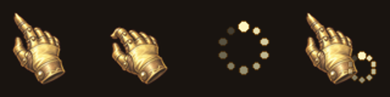

# Hearth Glove Cursor · 炉石风手套光标

[English](README.en.md) · [下载最新版本](https://github.com/Pizzzza11/hearth-glove-cursor/releases/latest) · [反馈问题](https://github.com/Pizzzza11/hearth-glove-cursor/issues)

一套适用于 Windows 的象牙白、浅金色幻想风鼠标指针。鼠标按下时，手套弯指并向左倾斜约 10°；加载圆环与文本 I 型指针使用同一配色。




## 三步开始

1. 在 [Releases](https://github.com/Pizzzza11/hearth-glove-cursor/releases/latest) 下载 `HearthGloveCursor-版本号-windows.zip`，不要选自动生成的 `Source code` 包。
2. 右键 ZIP → **全部解压缩**，打开解压后的文件夹。
3. 双击 **Install.cmd**，等待弹窗显示 `Installed and enabled`。

无需管理员权限，无需 Python、Git、PowerShell 升级或编译工具。安装与控制功能都在 EXE 内。

| 系统 | 运行环境 | 验证状态 |
| --- | --- | --- |
| Windows 7 SP1，32/64 位 | 系统自带的 .NET Framework 3.5 / CLR 2.0；如组件被精简需要先恢复 | 已针对旧 API 编译，尚无 Win7 虚拟机实测 |
| Windows 10/11 | 系统的 .NET Framework 4.x / CLR 4 | 当前 Windows 原生加载验证，CI 执行生命周期检查 |

程序为 AnyCPU，配置文件优先选择 CLR 4、再回退 CLR 2；请保留 EXE 旁的 `.exe.config`。兼容适配不等于所有系统已完成实际重启、游戏或显示缩放测试。ARM64 与远程桌面组合尚未逐一验证。[运行环境来源](https://learn.microsoft.com/en-us/dotnet/framework/install/on-windows-10) · [运行时选择规则](https://learn.microsoft.com/en-us/dotnet/framework/configure-apps/file-schema/startup/supportedruntime-element)

程序尚未购买代码签名证书，Windows 可能显示未知发布者或安全提示。请核对下载来源与发布页 SHA256；只在确认信任本项目时运行。企业应用策略可能阻止启动。

## 包含什么

| 角色 | 外观 / 行为 |
| --- | --- |
| 普通选择、链接选择 | 浅色手套 |
| 鼠标按下 | 弯指、左倾约 10°，至少显示 85 毫秒 |
| 后台工作 | 手套与浅金色旋转圆环 |
| 忙碌 | 浅金色旋转圆环 |
| 文本选择 | 象牙白、金色镶边的 I 型光标（静态） |

所有 CUR 和 ANI 帧均包含 32/48/64 三种尺寸。未替换缩放、禁止、十字等其他系统角色。文本输入框内闪烁的插入光标属于应用本身，不是这里替换的鼠标 I 型指针。

## 开关、恢复与卸载

解压目录和安装目录都提供以下入口：

| 双击文件 | 用途 |
| --- | --- |
| `Install.cmd` | 安装或升级，默认加入当前用户登录启动项 |
| `Stop.cmd` | 暂停点击检测、自动修复与看护；随后可以手动换系统光标方案 |
| `Start.cmd` | 重新启用全部自定义角色与动画 |
| `Status.cmd` | 显示进程数量、启动命令、角色路径与运行时版本 |
| `Uninstall.cmd` | 停止程序、撤销启动入口、恢复安装前的角色与方案名称 |

安装位置：`%LOCALAPPDATA%\HearthGloveCursor`。原方案保存为 `original-backup-v2.xml`，升级时不会覆盖。卸载后保留资源、日志和已恢复备份供排查；确认不再需要后可手动删除这个安装目录。卸载完成后重新安装，会备份当时的新方案。

`Stop.cmd` 会持续暂停，包括后续登录。执行 `Start.cmd` 恢复。暂停不会自动还原整套安装前设置；要还原请卸载。首次安装时不想开机启动，可在命令提示符运行 `Install.cmd --no-startup`。此参数不会撤销既有启动入口。

从旧的个人原型版迁移时，请先使用旧版卸载入口恢复原方案，保留并移走旧安装目录，再安装公开版。检测到旧 JSON 格式备份时，新安装器会提示迁移而不会覆盖原备份。

## 为什么有两个进程

一个主进程负责鼠标按键检测与光标修复，另一个是同一 EXE 的 `--watchdog` 看护模式。主进程退出后，看护会在约两秒后尝试重新启动；主进程也会检查并重建丢失的看护进程。命名互斥锁避免重复实例。

当前用户的注册表 Run 项直接启动 EXE，不依赖 PowerShell 或计划任务。主程序约每秒核对五个角色；任一角色被系统、游戏或主题覆盖，会恢复整套自定义设置。**如要使用其他鼠标主题，先执行 Stop.cmd 或卸载。**

程序每约 8 毫秒读取鼠标按键状态，没有键盘记录、网络通信、遥测或自动更新。极快的点击可能落在两次采样之间。看护与主程序如果同时被结束，或启动项被安全软件/用户禁用，不能保证自动恢复。系统锁屏、安全桌面、应用自绘鼠标和某些独占全屏游戏也不保证使用系统指针。

## 出现问题

- **重启后是默认指针**：执行 `Status.cmd`；正常为 2 个守护进程。确认系统启动项管理允许 `HearthGloveCursor`（Win7 可在 msconfig 中查看），然后执行 `Start.cmd`。
- **玩游戏后丢失某个角色**：回到普通桌面等待约一秒；仍不正常时执行 `Start.cmd`，并把 `Status.cmd` 输出附到 issue。
- **下载后打不开**：确保先解压 ZIP；不要在压缩包预览里直接运行。保留 `.exe.config`，检查弹窗错误、运行时组件和安全软件记录。最近管理操作结果保存在 `%TEMP%\HearthGloveCursor-management.txt`。
- **未找到 EXE**：下载 Release ZIP；源码 ZIP 不包含编译结果。
- **反馈隐私**：日志/状态可能包含本机用户名和路径，提交 issue 前请遮掉个人信息。不要上传备份 XML/JSON 或整个安装目录。

## 从源码构建

```powershell
powershell -NoProfile -ExecutionPolicy Bypass -File tools\Build.ps1 -Version 1.0.0
```

构建机需 Windows PowerShell 5.1+。构建脚本使用 .NET 3.5 编译器，缺少时从 NuGet 下载微软 3.5 引用程序集并使用系统 C# 编译器。输出 `dist/HearthGloveCursor-1.0.0-windows.zip` 与 `SHA256SUMS.txt`，调用 Windows 原生加载器逐项检验光标。发布的程序不需要构建工具或 PowerShell。重复构建同一版本时，请先移走旧的 `dist` 暂存目录，或使用新版本号。

如需重新生成图片资产（仅开发者需要 Python 3.10+）：

```powershell
python -m pip install -r requirements-dev.txt
python tools/build_cursors.py
python -m unittest discover -s tests -v
```

GitHub Actions 会在推送 main / PR 时验证资产并编译；推送 `v1.0.1` 等版本标签后，会发布带 ZIP 和校验值的 Release。Windows 构建与资产校验通过不等于已验证所有机器上的实际重启、游戏与缩放行为；请通过 issue 提供复现条件。

## 许可与设计来源

项目原创代码和自制素材采用 [MIT](LICENSE)。手套素材通过图像生成工具重新绘制，构建脚本处理提亮、旋转、尺寸与动画；设计过程见 [DESIGN.md](assets/DESIGN.md)。这是非官方的炉石风格爱好者项目，与 Blizzard Entertainment 无关联；相关游戏名称和第三方权利不属于本项目许可范围。详见 [NOTICE.md](NOTICE.md)。
